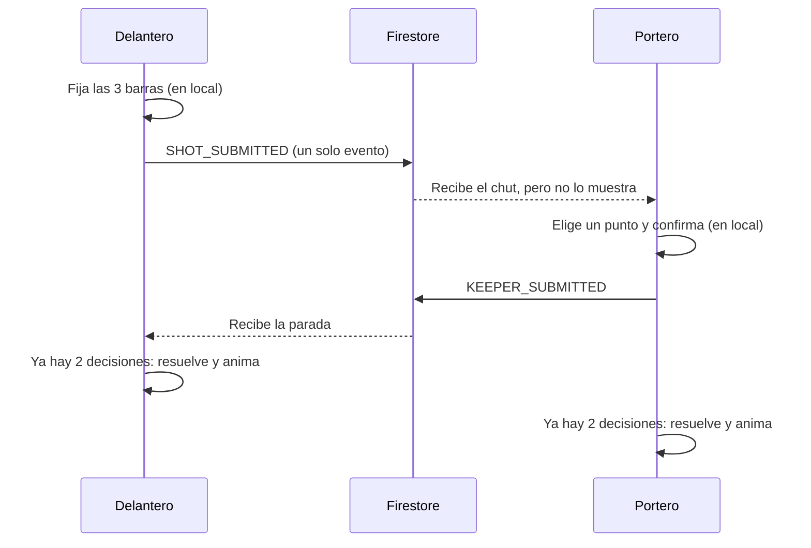

# ⚽ Penaltis 1 contra 1 · GDG Menorca

Juego web multijugador de penaltis, delantero contra portero, cada uno desde su propio ordenador.

Es un proyecto de **Google Developer Groups Menorca** para explicar de forma práctica cómo funciona **Firebase** (Cloud Firestore y Authentication), cómo se monta un **multijugador en tiempo real** y qué es el **event sourcing**. Se presenta en el evento abierto y gratuito de GDG Menorca del **12 de noviembre de 2026**.

## 🎬 Resultado final

[Penalties.webm](https://github.com/user-attachments/assets/1eeb5add-ffb6-46dc-9041-58e7d7fc5b3b)

## 🎮 Cómo jugar

1. Un jugador inicia sesión con Google y pulsa **Crear partida**. Obtiene un código de 6 caracteres y un enlace para compartir.
2. El otro jugador se une introduciendo el código o abriendo el enlace. Puede entrar como invitado (solo escribe un apodo) o con su cuenta de Google.
3. Se juegan 5 penaltis por jugador, alternando los roles en cada ronda. Si hay empate, se pasa a muerte súbita.
4. Cada jugador tiene **10 segundos** para decidir. Si se le acaba el tiempo, el juego completa su decisión al azar.
5. Al terminar, aparece la pantalla de fin del partido con el ganador y el botón **Ver repetición**, que reproduce la partida entera penalti por penalti.

### Si eres el delantero

Aparecen tres barras, una tras otra, con un marcador que se mueve de lado a lado. Pulsa **ESPACIO** para fijar cada una:

1. **Dirección horizontal:** hacia dónde va el tiro, de izquierda a derecha.
2. **Dirección vertical:** a qué altura.
3. **Potencia:** de 0 % a 100 %.

Las barras de dirección son algo más anchas que la portería, así que puedes tirar fuera.

### Si eres el portero

Haz clic en el punto de la portería donde quieres lanzarte y pulsa **Confirmar**. No sabes hacia dónde ni con qué fuerza va el tiro.

## ⚙️ Mecánica

El portero no para un punto, sino un **círculo** centrado donde ha hecho clic. El tamaño de ese círculo depende de la potencia del chut: cuanto más fuerte, más difícil de parar.
| Potencia del chut | Área que cubre el portero |
|---|---|
| 0 % | 2/3 de la portería |
| 50 % | 1/6 de la portería (como dividirla en 6 zonas) |
| 100 % | 1/9 de la portería |

Entre esos valores, el área se calcula de forma lineal.

El resultado de cada penalti se decide así:

- Si el tiro queda fuera de la portería, es **FUERA**.
- Si entra y cae dentro del círculo del portero, es **PARADA**.
- Si entra y cae fuera del círculo, es **GOL**.

Tirar flojo es preciso pero fácil de parar; tirar fuerte deja al portero casi sin margen, pero las barras son igual de difíciles de clavar.

## 🔧 Cómo funciona por dentro

### Sin servidor de juego

No hay ningún servidor que haga de árbitro. Cada ordenador ejecuta su propia copia completa del juego: dibuja la escena, lleva su temporizador y calcula el resultado. **Firestore solo envía las decisiones** de un jugador al otro.

Cada cliente abre una única suscripción en tiempo real (`onSnapshot`) a los eventos de la partida. Cuando alguien escribe un evento nuevo, Firestore se lo empuja a ambos jugadores, normalmente en menos de medio segundo.

### Flujo de una ronda



Mientras un jugador decide no se envía nada: ni cada barra por separado ni los movimientos del ratón. La decisión completa viaja como **un solo evento**. Cuando cada ordenador tiene las dos decisiones de la ronda, calcula el resultado en frontend.

### Event sourcing

En lugar de guardar el estado de la partida (marcador, ronda, turno), se guarda **una lista de los eventos**. El estado se calcula siempre en frontend a partir de esa lista con una función, el *reducer*:

```
estado = eventos.reduce(reducer, estadoInicial)
```

Solo existen cuatro tipos de evento:

| Evento | Qué contiene |
|---|---|
| `MATCH_CREATED` | Nombre del anfitrión y configuración |
| `PLAYER_JOINED` | Nombre del invitado y si es anónimo |
| `SHOT_SUBMITTED` | Dirección X e Y, potencia y los tiempos de las tres barras |
| `KEEPER_SUBMITTED` | Punto elegido por el portero y cuándo lo eligió |

Todo lo demás (el marcador, quién chuta en cada ronda, el resultado de cada penalti, la muerte súbita, el ganador) se deduce de esos eventos.

El juego ofrece **repeticiones de los penalties** aprovechando este modo de guardar los datos. Es similar a lo que usa Google Docs.

### Estructura de la base de datos

```
users/{uid}                     Perfil (solo cuentas de Google)
matches/{código}                Quién juega y estado de la partida
  └─ events/{id}                El log de eventos
       000-created
       000-joined
       001-shot
       001-keeper
       002-shot
       ...
```

- El **código de la partida es el id del documento**, así que no puede haber dos partidas con el mismo código.
- Los **ids de los eventos son deterministas** (`003-shot`, `003-keeper`). Si un jugador intenta enviar dos veces su decisión de la misma ronda, Firestore lo rechaza porque el documento ya existe.
- Los eventos **no se pueden borrar ni editar**: el log debe ser inmutable. El event sourcing es siempre así (salvo que quieras rescatar una copia antigua).

### Autenticación

- El anfitrión **debe** entrar con Google.
- El invitado puede entrar con Google o como invitado. En ese caso se usa **Anonymous Auth** de forma invisible: el jugador solo escribe un apodo, pero recibe un identificador válido que las reglas de seguridad pueden comprobar. Si recarga la página, conserva el mismo identificador y puede volver a la partida.

Así solo hace falta que uno de los dos tenga cuenta, sin renunciar a la seguridad.

## 🤖 El prompt

El juego se ha generado con **Google AI Studio** a partir de este prompt:

```
Crea un videojuego web multijugador de penaltis 1 contra 1 (delantero vs portero) en 2D con Canvas (sin Three.js: la cámara es fija y todos los gráficos son sprites SVG). Usa Firebase (Firestore + Authentication) para el multijugador. Toda la lógica de partida debe basarse en event sourcing.

## Recursos gráficos
Usa los SVG adjuntos: fondo.svg (1600x900), portero.svg, delantero.svg, pelota.svg. preview.svg muestra la composición de referencia.
Coordenadas del fondo (sistema de 1600x900, escalar el canvas manteniendo la proporción):
- Boca de portería (interior de postes hasta el larguero): x=500, y=379.5, ancho=600, alto=200.1 (rect con id="goal-mouth" en fondo.svg).
- Línea de gol: y=579.6. Escala en la línea de gol: 82 px/m.
- Punto de penalti: (800, 811.5).

## Escena inicial de cada turno
Al empezar cada turno, la pantalla debe verse igual que preview.svg:
- Fondo completo.
- Portero centrado en x=800, con los pies (centro de su sombra, y=310 en su viewBox de 180x320) sobre la línea de gol y=579.6, con una altura total de unos 165 px (escala ≈ 0.517).
- Pelota de 46 px de diámetro apoyada sobre el punto de penalti, con una pequeña sombra elíptica debajo.
- Delantero de espaldas a la izquierda, centrado en x≈330, con los pies (y=402 en su viewBox de 190x420) en y≈895, escala ≈ 1.036. Está fuera de la portería para no tapar la zona de tiro.
- Sobre esta escena se dibuja el panel de decisión de cada rol (barras o selector del portero), el marcador y el temporizador.

## Concepto
- Dos jugadores, cada uno en su propio ordenador. Uno controla al delantero y el otro al portero.
- Ninguno ve lo que hace el otro mientras decide. Las decisiones solo se revelan cuando ambos han terminado.
- Cada jugador tiene 10 segundos para decidir. Si se agota el tiempo, su propio cliente completa la decisión de forma aleatoria y la envía (al delantero se le fijan al azar las barras que le falten; al portero se le asigna un punto al azar dentro de la portería).
- Ambos jugadores ven exactamente la misma vista.

## Panel de decisión
- El panel de decisión (las barras del delantero, o el punto de mira y el botón "Confirmar" del portero) solo es visible mientras el jugador tiene tiempo restante y todavía no ha enviado su decisión.
- Al llegar el temporizador a 0, el panel se oculta inmediatamente y deja de aceptar entradas (ESPACIO, clics), aunque la decisión estuviera a medias. La parte que faltara se completa al azar sin mostrarla en pantalla.
- También se oculta en cuanto el jugador envía su decisión antes de tiempo.
- En ambos casos, en su lugar se muestra solo el mensaje "Esperando al rival…" (o directamente la animación, si el rival ya había decidido).

## Arquitectura de ejecución
- Cada ordenador ejecuta su propia instancia completa del juego: render, temporizador, reducer y resolución de la jugada. Firestore solo transporta las decisiones; no hay ningún cliente ni servidor que haga de árbitro.
- Cada cliente se suscribe con onSnapshot al log de eventos de la partida y aplica el reducer sobre los eventos recibidos.
- Flujo de cada ronda en cada cliente:
  1. Se muestra la escena inicial con el panel de decisión y arranca el temporizador local de 10 s.
  2. El jugador decide localmente. Nada se envía mientras decide: ni cada barra por separado, ni los movimientos del ratón del portero.
  3. Cuando la decisión está completa, se envía en UN SOLO evento y se oculta el panel:
     - Delantero: al fijar la tercera barra (dirección vertical), se envía un único SHOT_SUBMITTED con potencia, X, Y y los tiempos de las tres barras.
     - Portero: al pulsar "Confirmar", se envía un único KEEPER_SUBMITTED.
  4. Si el tiempo se agota sin decisión completa, se oculta el panel, el propio cliente genera la parte que falte al azar y envía el evento con auto=true.
  5. En cuanto el reducer tiene las dos decisiones de la ronda, cada cliente resuelve la jugada localmente y reproduce la animación. La resolución es una función pura y determinista de las dos decisiones, así que ambos clientes obtienen siempre el mismo resultado.
  6. Mientras falta la decisión del rival, se muestra "Esperando al rival…" con el tiempo que le queda.
- Si la decisión del rival no llega dentro de los 10 s más un margen de 5 s, se muestra "Rival desconectado", con las opciones de seguir esperando o salir. Un cliente nunca envía decisiones en nombre del otro jugador.
- Los temporizadores son locales de cada cliente. Un pequeño desfase entre ambos es aceptable.

## Cuentas y acceso
- El anfitrión DEBE iniciar sesión con Google para crear una partida.
- El invitado puede entrar de dos formas: como invitado (Firebase Anonymous Auth, solo pide un apodo) o con su cuenta de Google.
- Firebase Anonymous Auth se usa de forma invisible: el invitado no ve ningún login, solo escribe su apodo. Así tiene un uid válido para las reglas de seguridad, y si recarga la página conserva el mismo uid (persistencia local) y puede volver a la partida.
- Si un invitado anónimo decide después entrar con Google, vincula la cuenta con linkWithPopup para conservar el mismo uid.

## Lobby
- Pantalla inicial con dos opciones: "Crear partida" (requiere Google; si no hay sesión, abre el login de Google) y "Unirse a partida".
- Al crear partida se genera un código corto de 6 caracteres sin caracteres ambiguos (sin 0/O, 1/I/L). El anfitrión ve el código en grande, un botón "Copiar enlace" y un botón "Compartir" (Web Share API si está disponible). El enlace tiene el formato: https://<dominio>/?code=ABC123
- Unirse: introduciendo el código a mano, o abriendo directamente el enlace. Si la URL trae ?code=, se salta la pantalla inicial y muestra directamente "Unirse a la partida ABC123" con dos botones: "Entrar como invitado" (pide apodo) y "Entrar con Google".
- Mensajes de error claros: código inexistente, partida llena, partida terminada.
- Al unirse el segundo jugador, la partida empieza. El anfitrión chuta primero y los roles se alternan en cada ronda.
- Formato: 5 penaltis por jugador y muerte súbita si hay empate (número configurable).

## Estructura de la base de datos (Firestore)
- users/{uid}: solo para cuentas de Google. Contiene { displayName, photoURL, createdAt }. Los invitados anónimos no tienen documento aquí.
- matches/{code}: el propio código es el id del documento, de modo que crear la partida falla si ese código ya existe; en ese caso se genera otro. Es metadato de acceso, NO estado de juego:
  { code, hostUid, hostName, guestUid: null | uid, guestName: null | string, guestIsAnonymous: bool, status: "waiting" | "playing" | "finished", createdAt, config }
- matches/{code}/events/{eventId}: el log de eventos. El id es determinista y ordenable:
  - "000-created" para MATCH_CREATED
  - "000-joined" para PLAYER_JOINED
  - "{ronda con 3 dígitos}-shot" para SHOT_SUBMITTED (ej. "003-shot")
  - "{ronda con 3 dígitos}-keeper" para KEEPER_SUBMITTED (ej. "003-keeper")
  Así cada jugador solo puede enviar una decisión por ronda: un segundo intento falla porque el documento ya existe. Los eventos se ordenan por id.
- Para unirse, el invitado hace una transacción que escribe guestUid, guestName, guestIsAnonymous y status="playing", solo si guestUid es null. Después emite PLAYER_JOINED.
- Cuando el reducer detecta el final de la partida, el anfitrión actualiza status a "finished".

## Reglas de seguridad (incluirlas en firestore.rules)
- users/{uid}: lectura y escritura solo por ese mismo uid.
- matches/{code}:
  - create: solo con sesión de Google (request.auth.token.firebase.sign_in_provider == "google.com"), con hostUid == request.auth.uid, guestUid == null y status == "waiting".
  - read: cualquier usuario autenticado (anónimo incluido), para poder comprobar el código antes de unirse.
  - update para unirse: solo si resource.data.guestUid == null, el nuevo guestUid == request.auth.uid y solo cambian guestUid, guestName, guestIsAnonymous y status (usar diff().affectedKeys().hasOnly([...])).
  - update de status a "finished": solo el anfitrión.
  - delete: nunca.
- matches/{code}/events/{eventId}:
  - read: solo hostUid o guestUid de esa partida (usar get() sobre el documento de la partida).
  - create: solo jugadores de la partida y con playerId == request.auth.uid. Solo se permite crear; nunca sobrescribir.
  - update y delete: nunca.

## Sistema de coordenadas del tiro
- Portería real: 7,32 m de ancho × 2,44 m de alto.
- Coordenadas normalizadas sobre la portería: x ∈ [0,1] (izquierda→derecha), y ∈ [0,1] (abajo→arriba).
- Conversión a píxeles del fondo: px = 500 + x·600 ; py = 579.6 − y·200.1.
- Los cálculos de distancias y áreas se hacen en metros, para que el círculo del portero sea un círculo real.

## Mecánica del delantero
El chut se compone de tres barras deslizantes, una tras otra, todas gestionadas en local. En cada una, un marcador va de un extremo a otro en bucle (ping-pong) y ESPACIO lo detiene:
1. Barra de potencia: de 0% a 100%. Se mueve a la velocidad base. ESPACIO fija la potencia.
2. Barra horizontal (dirección X): ESPACIO fija X.
3. Barra vertical (dirección Y): ESPACIO fija Y y en ese momento se envía SHOT_SUBMITTED con todo el chut.
- La velocidad de las barras de dirección depende de la potencia elegida: velocidad = velocidad base × (1 + 2 × potencia). Con potencia 0% van a la velocidad base, con 100% van al triple, y entre medias la relación es lineal.
- Esto crea el dilema del delantero: más potencia hace más pequeño el círculo del portero, pero también hace más difícil apuntar.
- Las barras de dirección cubren un rango algo mayor que la portería (de -0.15 a 1.15), para que se pueda fallar el tiro fuera.
- La velocidad base debe exigir habilidad sin ser imposible (configurable).
- Se guarda en local el instante de inicio y de parada de cada barra (en ms relativos al inicio del turno), para incluirlos en el evento.
- Si el tiempo se agota antes de fijar la potencia, se elige una potencia al azar y luego X e Y al azar.
- Tras enviar, el delantero queda a la espera del portero.

## Mecánica del portero
- El portero hace clic en un punto de la portería. Se convierte de píxeles a coordenadas normalizadas y se limita al interior de la portería. Ese punto es el centro de su zona de parada.
- El portero NO conoce la potencia ni la dirección del tiro al elegir.
- Mientras mueve el ratón sobre la portería, se muestra un punto de mira. Tras hacer clic, puede cambiar de punto hasta pulsar "Confirmar". Al confirmar se envía KEEPER_SUBMITTED.

## Zona de parada (círculo del portero)
El área del círculo es una fracción del área de la portería que depende de la potencia del chut:
- Potencia 0% → 2/3 del área
- Potencia 50% → 1/6 del área (caso normal: equivale a 6 zonas, izquierda/centro/derecha × arriba/abajo)
- Potencia 100% → 1/9 del área
- Entre esos puntos, interpolación lineal.
- Radio en metros: r = sqrt(fracción × 7,32 × 2,44 / π). En píxeles: r × 82.

## Resolución
- Función pura resolve(shot, keeper) en reducer.js, ejecutada en ambos clientes:
- Si el tiro queda fuera de la portería → FUERA.
- Si está dentro y la distancia al centro del portero es ≤ r → PARADA.
- Si está dentro y fuera del círculo → GOL.

## Animación del resultado
- Los personajes son siempre el mismo SVG estático: no hay fotogramas de carrera, chut ni estirada, y nunca se cambia el sprite. Todo el movimiento se hace transformando los sprites en el canvas (traslación, escala y rotación), animado con requestAnimationFrame y easing.
- Cuando el reducer tiene las dos decisiones de la ronda, se reproduce esta secuencia:
  1. El delantero se desplaza unos 40 px hacia la pelota (200 ms).
  2. La pelota viaja desde el punto de penalti hasta el punto del tiro. Su duración depende de la potencia: 900 ms al 0% y 350 ms al 100%. Sigue una ligera curva parabólica y va encogiendo de 46 px a unos 18 px para simular la profundidad. Si el tiro va fuera, continúa un poco más allá de la portería.
  3. El portero arranca a la vez que la pelota y llega a su punto al mismo tiempo. Se traslada hacia la x del punto y se eleva si el punto es alto. Además rota hacia el lado de la estirada, hasta unos ±60° cuanto más lejos del centro esté el punto.
  4. Si es PARADA, la pelota rebota hacia delante y hacia un lado y cae al césped. Si es GOL, se queda en la red.
- Después se muestra durante 3 s el círculo de parada (semitransparente), el punto de impacto y un rótulo grande con GOL / PARADA / FUERA. Luego todo vuelve a la escena inicial para el siguiente turno.
- Marcador visible en todo momento.

## Event sourcing
- Cada evento: { type, playerId, round, payload, clientTs, serverTs }.
- Tipos:
  - MATCH_CREATED { hostName, config }
  - PLAYER_JOINED { name, isAnonymous }
  - SHOT_SUBMITTED { power, x, y, bars: { power: {startMs, lockMs}, x: {startMs, lockMs}, y: {startMs, lockMs} }, auto }
  - KEEPER_SUBMITTED { x, y, decidedMs, auto }
- "auto" indica que la decisión (o parte de ella) la completó el cliente por tiempo agotado.
- Todo lo demás se deriva SIEMPRE aplicando el reducer puro sobre la lista de eventos: ronda actual, roles de cada ronda (el anfitrión chuta en las rondas impares), resultado de cada ronda, marcador, muerte súbita y final de partida. No se guarda estado derivado.
- Ocultación: aunque el cliente reciba la decisión del rival antes de haber decidido, no la usa ni la dibuja hasta que existan las dos decisiones de la ronda.

## Fin de partida y repetición
- Durante la partida NO hay repeticiones: no existe ningún botón de repetición entre penaltis.
- Cuando el reducer detecta el final (tras los 5 penaltis de cada jugador, o al decidirse la muerte súbita), ambos clientes muestran la pantalla "Fin del partido" con el ganador, el marcador final y el resumen de cada penalti (ronda, quién chutó y resultado).
- En esa pantalla hay un botón "Ver repetición" que reproduce la partida entera, penalti por penalti, desde la ronda 1 hasta la última (incluida la muerte súbita, si la hubo).
- La repetición se construye exclusivamente recorriendo el log de eventos desde el principio y pasándolo por el mismo reducer y el mismo código de render y animación que la partida en directo. No se guarda nada específico para la repetición.
- Para cada penalti se reproduce: las barras moviéndose y parándose en el orden potencia, X, Y (usando startMs y lockMs), el clic del portero (decidedMs), la animación del resultado y el marcador actualizándose. Entre penaltis, un rótulo breve con "Penalti N – [nombre del delantero]". Si una decisión fue automática (auto=true), en la repetición no se muestran las barras ni el punto de mira de la parte completada al azar, igual que en directo.
- Las barras de dirección se reproducen a la velocidad que les correspondía según la potencia, con la misma fórmula de config.js que en directo. En el instante lockMs, el marcador se coloca exactamente en el valor guardado en el evento.
- Controles: reproducir, pausa, velocidad x0.5 / x1 / x2, penalti anterior / siguiente y salir de la repetición.
- Como la partida terminada sigue en Firestore, la repetición también funciona si un jugador recarga la página después del final.

## Técnico
- Módulos: firebase.js (auth, partidas, envío y suscripción de eventos), reducer.js (estado y resolve a partir de eventos), render.js (canvas y sprites), ui.js (lobby, panel de decisión, marcador, temporizador, pantalla de fin de partido), replay.js (recorre el log y reutiliza reducer.js y render.js).
- Constantes en config.js: fracciones de área, velocidad base de las barras, multiplicador máximo de velocidad por potencia (3), rango de dirección, tiempo límite (10 s), margen de desconexión (5 s), número de penaltis, duraciones de la animación, coordenadas del fondo y escalas de los sprites.
- Precargar los SVG como imágenes antes de mostrar la partida.
- Incluir firestore.rules con las reglas descritas.

Usa JavaScript vanilla con módulos ES (sin React, sin TypeScript, sin frameworks). Un solo index.html con el canvas y unos pocos elementos HTML para el lobby y la pantalla final. La suscripción onSnapshot se crea una única vez al entrar en la partida y se cancela solo al salir; nunca se recrea entre rondas.
```

## 🚀 Recrear el juego

1. Crea un proyecto de Google Cloud (si no lo tienes ya) y activa la facturación.
2. Si, como yo, no quieres pagar por experimentar un poco, Google ofrece $5 en créditos (ojo que acaban a las 24 horas). Puedes canjearlos desde este CodeLab: https://codelabs.developers.google.com/codelabs/cloud-run/launch-your-web-based-video-game-with-ai?hl=es-419#0
3. Pega el prompt y los SVGs en el AI Studio. Mientras esperas, léete el funcionamiento en este readme para que tengas una foto completa de cómo funciona. También puedes pensar qué mejoras quieres añadirle al juego.
4. Una vez haya terminado, prueba el juego. Probablemente no te funcionará porque, aunque AI Studio cree y configure las DB de Firebase, siempre lo hace con permisos muy restrictivos. Debes probar un poco y pedirle que lo solucione.
5. Publica el juego.
6. Si te da problemas con la facturación, debes pulsar "Setup billing".


## 🎨 Gráficos

Los sprites (fondo, portero, delantero y pelota) son SVG originales creados para este proyecto. Los personajes no tienen animaciones propias: todo el movimiento se consigue moviendo, escalando y rotando los sprites en el canvas.

---

Hecho con 💙 por [GDG Menorca](https://gdg.community.dev/)
